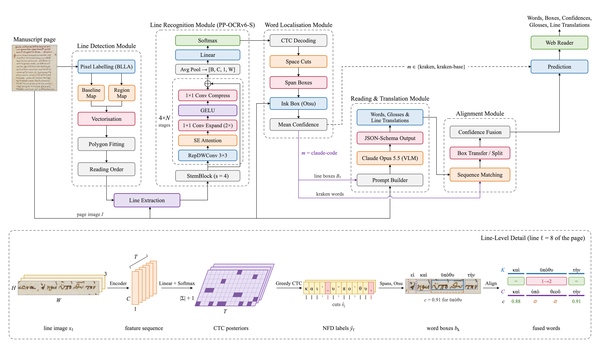

# Lexis - Ancient Greek Text Assistant

Lexis (Greek λέξις, "word") is the project name; the web app shows it as Λέξις.

A tool that helps students, researchers, and anyone interested in Ancient Greek **read, understand, and learn from Ancient Greek texts**.

Upload a page image and explore recognized words and their translations.

## How it works



kraken finds the lines on the page, a PP-OCRv6-S model fine-tuned on Eparchos reads them, and every word gets a box and a confidence. With the `claude-code` model, Claude Opus 5.5 also reads and translates each line, and its words are matched with kraken's. The bottom strip follows one line of Eparchos page 6791 (1) from the [Eparchos dataset](https://zenodo.org/records/4095301) (CC BY 4.0). Details are in the [model cards](docs/models/README.md).

## Features

- Upload or capture an image of a text.
- Explore recognized words and their positions on the page.
- View translations in the Ancient Greek demo.
- Save and revisit previous results.
- Send photos from your phone to the web app.

> **Note:** The current Ancient Greek demo uses a fixed Eparchos sample result. It demonstrates the word-level experience but does not yet recognize and translate arbitrary Ancient Greek pages.

## Quick start

**Requirements:** Python 3.13+, uv, Node.js 24+, and npm.

1. Clone the repository:

   ```bash
   git clone https://github.com/muhammadov-q/lexis.git
   cd lexis
   ```

2. Start the backend (Terminal 1):

   ```bash
   cd backend
   uv sync
   ML_PREDICTOR="eparchos" uv run uvicorn app.main:app --reload
   ```

3. Start the web app (Terminal 2, from the repository root):

   ```bash
   cd frontend
   npm install
   npm run dev
   ```

4. Open [http://localhost:3000](http://localhost:3000).

To try the Ancient Greek demo, upload `6791 (1).png` from the [Eparchos dataset](https://zenodo.org/records/4095301). The sample image is needed for the word boxes to align with the results.

## Project structure

| Directory | Description |
|---|---|
| `frontend/` | Next.js web application |
| `backend/` | FastAPI service |
| `mobile/` | Kotlin Multiplatform mobile app |
| `docs/` | Requirements, architecture, and development workflow |

**Documentation:** [Frontend](frontend/README.md) · [Backend](backend/README.md) · [Mobile](mobile/README.md) · [Project docs](docs/README.md)

Built for the Advanced Software Engineering MSc course at the University of Fribourg.

## Project Resources

| Resource | Location |
|---|---|
| Midterm Presentation | [Presentation Slides](docs/presentations/mid-term-2026.pptx) |
| Demo Video | [Web app demo, 2 min](docs/presentations/demo-2026.mp4) |
| User Stories | [GitHub Issues](docs/workflow/issues.md) |
| Architecture & Design | [Documentation](docs/architecture/README.md) |
| Machine Learning | [ML Documentation](docs/ml/README.md) |
| Development Workflow | [Workflow Documentation](docs/workflow/README.md) |
| All Documentation | [Docs Overview](docs/README.md) |