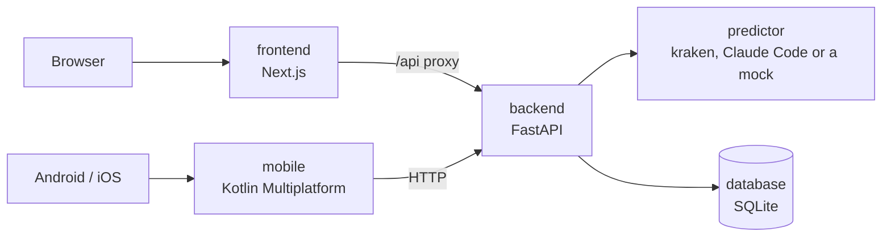

# System overview

What exists today (as of 2026-11): a web app, an Android and iOS app, and a backend with sign-in, a results history, a vocabulary and phone capture. The backend reads pages with kraken, or with Claude Code on your own computer. Mock models keep the whole path working without the `ml` extra.

## Stack

| Part       | Stack                                                                       | More                                                       |
| ---------- | --------------------------------------------------------------------------- | ---------------------------------------------------------- |
| Web app    | Next.js 16, React 19, TypeScript, TanStack Query, Tailwind CSS 4, shadcn/ui | [[architecture/frontend]], [[adr/0001-web-frontend-stack]] |
| Mobile app | Kotlin Multiplatform, Compose Multiplatform, Ktor, Koin                     | `mobile/README.md`                                         |
| Backend    | Python 3.13, FastAPI, uv                                                    | `backend/README.md`, [[architecture/api-contract]]         |
| Database   | SQLite, SQLAlchemy 2, Alembic                                               | [[architecture/database]], [[adr/0003-sqlite-database]]    |
| Tests      | Vitest, Playwright, pytest, Bruno, kotlin.test                              | [[architecture/testing]]                                   |
| CI         | GitHub Actions                                                              | [[workflow/git-workflow]]                                  |

The mobile app runs on Android and iOS and calls the backend directly, with the same session cookie and endpoints as the web app. Accounts live in the database ([[architecture/database]]). Page images from the web app are kept in the database for the results history ([[adr/0004-page-images-in-sqlite]]). Phone capture sessions (a phone sends a photo to the web app through a QR code) live in the backend's memory, so a restart drops them.
